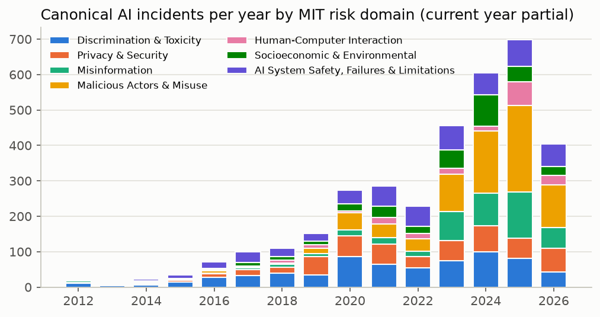
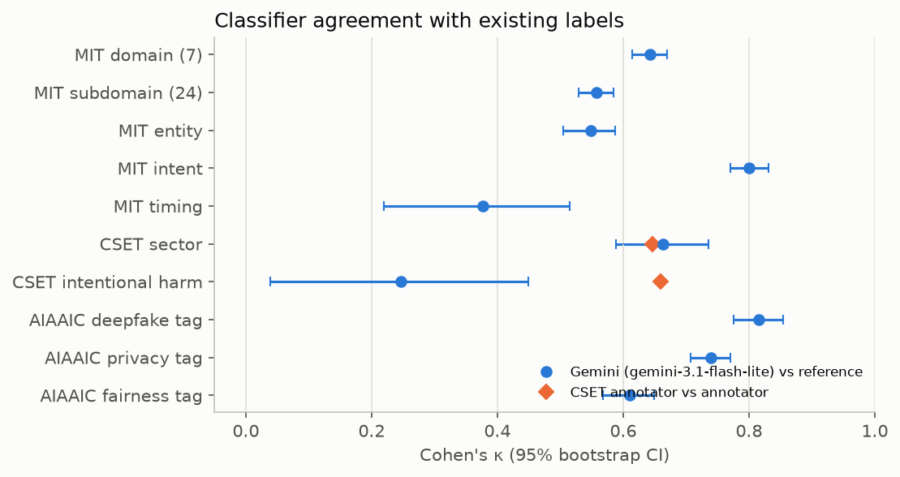
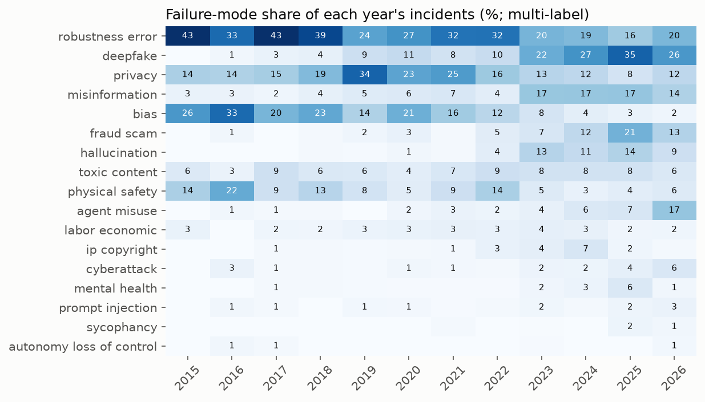
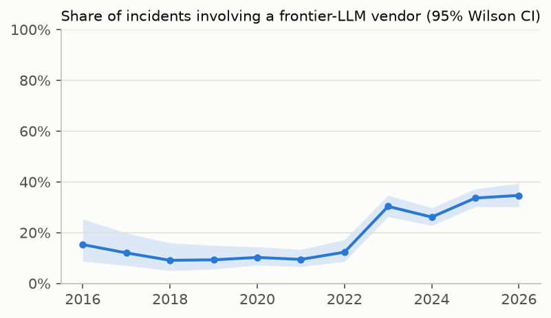
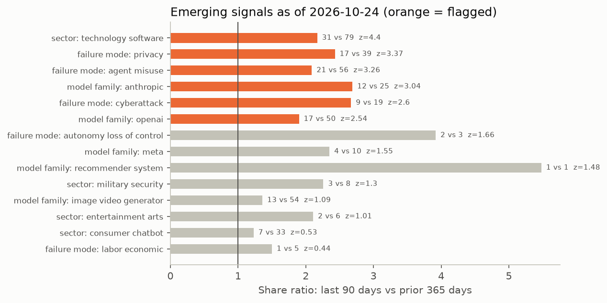

# AI Incident Radar

**An open, weekly-refreshed AI incident intelligence pipeline: ingest → deduplicate → classify → validate → detect emerging signals.**

**Dashboard:** https://rishikeshn-eng.github.io/ai-incident-radar/ · **Data:** [`docs/data/`](docs/data) · **Validation:** [`results/validation.json`](results/validation.json)



## Problem

When an aircraft crashes, an independent investigator (NTSB, AAIB, BEA) collects evidence, classifies root causes into a shared taxonomy, and publishes trends the whole industry learns from. AI has nothing comparable. Evidence about real-world AI failures is scattered across volunteer databases, journalism, and forum posts, each with its own schema, coverage and lag. Coefficient Giving's [Project Tailwind](https://80000hours.org/podcast/episodes/max-nadeau-project-tailwind-technical-ai-grants/) lists third-party evidence generation and incident detection among the AI safety problems that "no one currently owns".

Concretely:
- The two largest public collections, the [AI Incident Database](https://incidentdatabase.ai) (AIID) and the [AIAAIC Repository](https://www.aiaaic.org/aiaaic-repository), overlap heavily but share no IDs. Counting either one alone double-counts nothing and misses a lot; naively adding them double-counts a lot.
- Human taxonomy coverage is thin. CSET's AI Harm Taxonomy v1, the most detailed human annotation, covers about 200 published AIID incidents out of 1,751.
- Curated databases lag. AIID incidents dated in the last 90 days are a fraction of the yearly rate, so any "what is new" view needs faster community signals (Hacker News, Reddit), which are noisy and mostly not incidents.

This project builds the missing layer: a reproducible pipeline that merges these sources, labels every incident in one safety-oriented taxonomy, measures how far those labels can be trusted, and flags categories that are rising.

## What it does

| Stage | Module | What happens |
|---|---|---|
| 1. Ingest | [`radar/ingest.py`](radar/ingest.py) | Latest AIID full snapshot (incidents + reports + taxonomy CSVs), the AIAAIC "Incidents" sheet, Hacker News stories via the Algolia API (40 incident-oriented queries, ≥20 points, last 455 days), Reddit public JSON (skipped if blocked, which it currently is: HTTP 403). |
| 2. Dedupe + cluster | [`radar/dedupe.py`](radar/dedupe.py) | `bge-base-en-v1.5` embeddings (local ONNX via fastembed, cached). **Retrieve-then-verify:** each record's top-2 neighbours above a cosine floor (AIAAIC→AIID within ±1 year; HN→curated incidents; HN↔HN within 30 days) go to a batched Gemini judge ("same real-world event?", cached), and confirmed pairs are merged with union-find. Pure similarity thresholds failed here: two *different* fatal robot-arm accidents scored 0.83, while true duplicates sat at 0.75. Topic clusters: spherical k-means (k=40) on incidents that pass the incident filter, named with c-TF-IDF over titles. |
| 3. Classify | [`radar/classify.py`](radar/classify.py) | Gemini `gemini-3.1-flash-lite` (structured JSON output, temperature 0, 20–25 records per call; blocked batches are bisected to isolate the record that triggers the filter) assigns: MIT AI Risk Repository subdomain (24) → domain (7), MIT entity / intent / timing, multi-label **failure modes** (hallucination, sycophancy, agent misuse, prompt injection, deepfake, bias, privacy, autonomy / loss-of-control signals, and 9 more), severity 1–5, harm types, sector, model family, and an `is_ai_incident` filter for community posts. Every response is cached in [`labels/`](labels), so reruns only pay for new incidents. |
| 4. Validate | [`radar/validate.py`](radar/validate.py) | Cohen's κ, accuracy and macro-F1 with 1,000-sample bootstrap CIs against three independent label sets (below), plus a human–human baseline from CSET's individual annotator files and an LLM-judge audit of the dedupe thresholds. |
| 5. Trends + signals | [`radar/trends.py`](radar/trends.py) | Yearly counts and shares by MIT domain, failure mode, sector, model family and harm type; mean severity with CIs; LLM-vendor share with Wilson CIs. **Emerging signals:** share of each category among day-dated incidents in the last 90 days vs the previous 365 days, as a log share-ratio z-test. |
| 6. Report | [`radar/figures.py`](radar/figures.py), [`radar/report.py`](radar/report.py) | Figures, plus this README's Results section and `STATUS.md`, regenerated from `results/*.json` on every run. |
| 7. Publish | [`docs/`](docs), [`.github/workflows/refresh.yml`](.github/workflows/refresh.yml) | Static GitHub Pages dashboard (search, 7 filters, CSV export, charts, signal cards, validation table). A weekly GitHub Action reruns everything with the `GEMINI_API_KEY` repo secret and commits the refreshed data. |

<!-- RESULTS:START -->
## Results

*Generated 2026-10-24 from AIID snapshot `20261019101022`; classifier `gemini-3.1-flash-lite`.*

### Data

| Source | Records ingested | Classified | Canonical incidents (primary source) |
|---|---:|---:|---:|
| AI Incident Database | 1,751 | 1,749 | 1,728 |
| AIAAIC Repository | 2,259 | 2,257 | 1,771 |
| Hacker News (Algolia) | 1,282 | 705 | 138 |
| Reddit | 0 | 0 | 0 |

- Reddit: skipped (HTTP 403 / unreachable).
- 577 Show/Launch/Ask/Tell HN posts are skipped before classification (product launches and discussions, not incident reports). Of the HN stories classified, only those the classifier marks `is_ai_incident` enter the analysis.
- **Dedupe:** 942 candidate pairs retrieved by embedding similarity; the LLM judge confirmed 586 (96% of candidates judged; the rest fell back to cosine ≥ 0.9). **421 AIAAIC entries merged into AIID incidents**, so naive concatenation would double-count about 19% of AIAAIC. 5,292 records → 4,718 canonical incidents; 3,637 enter the analysis.
- **Dedupe audit** (pairs *below* the retrieval threshold, judged by the same LLM): aiaaic-aiid: cos 0.64-0.70 → 3% duplicates (n=30), cos 0.70-0.76 → 13% duplicates (n=30); news-incident: cos 0.62-0.68 → 23% duplicates (n=30), cos 0.68-0.74 → 0% duplicates (n=30). Estimated duplicates missed in those bins: {'aiaaic-aiid': 69, 'news-incident': 88}.

### Classifier validation



| Reference labels | Field | n | Gemini κ [95% CI] | Accuracy | Human–human κ |
|---|---|---:|---:|---:|---:|
| MIT (LLM-generated, see note) | Risk domain (7) | 1496 | 0.64 [0.61, 0.67] | 0.72 | – |
| MIT (LLM-generated, see note) | Risk subdomain (24) | 1496 | 0.56 [0.53, 0.58] | 0.61 | – |
| MIT (LLM-generated, see note) | Entity (AI/Human/Other) | 1496 | 0.55 [0.50, 0.59] | 0.77 | – |
| MIT (LLM-generated, see note) | Intent | 1496 | 0.80 [0.77, 0.83] | 0.90 | – |
| MIT (LLM-generated, see note) | Timing | 1496 | 0.38 [0.22, 0.52] | 0.97 | – |
| CSET v1 (human) | Sector, 10 coarse classes | 201 | 0.66 [0.59, 0.74] | 0.72 | 0.65 |
| CSET v1 (human) | Intentional harm | 191 | 0.25 [0.04, 0.45] | 0.87 | 0.66 |
| CSET v1 (human) | Severity vs tangible-harm level (Spearman ρ) | 198 | 0.36 [0.23, 0.48] | – | (4-class tangible harm κ = 0.70) |
| CSET v1 (human) | Severity AUROC: tangible harm occurred | 198 | 0.69 [0.62, 0.77] | – | – |
| CSET v1 (human) | Severity AUROC: lives lost > 0 | 213 | 0.95 [0.86, 0.99] | – | – |
| AIAAIC (editorial) | Deepfake (technology tag) | 2257 | 0.81 [0.78, 0.85] | F1 0.83 | – |
| AIAAIC (editorial) | Privacy (ethical-issue tag) | 2257 | 0.74 [0.71, 0.77] | F1 0.80 | – |
| AIAAIC (editorial) | Fairness/bias (ethical-issue tag) | 2257 | 0.61 [0.57, 0.65] | F1 0.68 | – |

- **Sector** agreement with CSET's human annotators (κ 0.66) is in the range of CSET annotators agreeing with each other (κ 0.65). **Severity** ranks incidents with deaths almost perfectly (AUROC 0.95; mean severity 4.83 when lives were lost), but correlates only moderately with CSET's 4-level tangible-harm scale (ρ 0.36).
- **Intentional harm is the weak field** (κ 0.25 vs human–human 0.66). Part of this is a construct mismatch: CSET asks whether the *system was designed* to harm, while the radar's `intent` asks whether *anyone* intended the harm, so a deepfake scam counts as intentional here but usually not in CSET.
- **About the MIT reference:** the MIT risk-domain labels shipped in the AIID snapshot were themselves produced by an LLM pipeline (MIT AI Incident Tracker, Claude Sonnet, about 80% consistency with expert ratings per its authors). Agreement with them measures consistency between two model-based classifiers, not accuracy. The CSET rows are the human ground truth.
- Full confusion matrices and per-domain precision/recall: [`results/validation.json`](results/validation.json).

### Trends



Share of incidents tagged with each failure mode, 2022 vs 2025 (95% Wilson CIs). Shares, not counts, because coverage grew.

| Failure mode | 2022 | 2025 | Δ share |
|---|---:|---:|---:|
| deepfake | 10.1% [6.8%–14.7%] (23/228) | 34.6% [31.2%–38.2%] (242/699) | +24.5% |
| fraud scam | 4.8% [2.7%–8.4%] (11/228) | 20.7% [17.9%–23.9%] (145/699) | +15.9% |
| misinformation | 4.4% [2.4%–7.9%] (10/228) | 17.0% [14.4%–20.0%] (119/699) | +12.6% |
| hallucination | 4.4% [2.4%–7.9%] (10/228) | 13.6% [11.2%–16.3%] (95/699) | +9.2% |
| mental health | 0.4% [0.1%–2.4%] (1/228) | 6.2% [4.6%–8.2%] (43/699) | +5.7% |
| agent misuse | 2.2% [0.9%–5.0%] (5/228) | 7.0% [5.3%–9.2%] (49/699) | +4.8% |
| cyberattack | 0.9% [0.2%–3.1%] (2/228) | 3.7% [2.5%–5.4%] (26/699) | +2.8% |
| sycophancy | 0.0% [0.0%–1.7%] (0/228) | 2.3% [1.4%–3.7%] (16/699) | +2.3% |
| prompt injection | 0.9% [0.2%–3.1%] (2/228) | 2.1% [1.3%–3.5%] (15/699) | +1.3% |
| autonomy loss of control | 0.0% [0.0%–1.7%] (0/228) | 0.1% [0.0%–0.8%] (1/699) | +0.1% |
| toxic content | 9.2% [6.1%–13.7%] (21/228) | 8.2% [6.3%–10.4%] (57/699) | -1.1% |
| ip copyright | 3.1% [1.5%–6.2%] (7/228) | 2.0% [1.2%–3.3%] (14/699) | -1.1% |
| labor economic | 3.1% [1.5%–6.2%] (7/228) | 1.7% [1.0%–3.0%] (12/699) | -1.4% |
| privacy | 16.2% [12.0%–21.6%] (37/228) | 7.9% [6.1%–10.1%] (55/699) | -8.4% |
| bias | 12.3% [8.6%–17.2%] (28/228) | 3.0% [2.0%–4.5%] (21/699) | -9.3% |
| physical safety | 14.5% [10.5%–19.6%] (33/228) | 4.4% [3.1%–6.2%] (31/699) | -10.0% |
| robustness error | 32.0% [26.3%–38.3%] (73/228) | 15.9% [13.4%–18.8%] (111/699) | -16.1% |



Incidents tied to a frontier-LLM vendor went from 12% [9%–17%] of the total in 2022 to 34% [30%–37%] in 2025.

### Emerging signals (last 90 days)



Window 2026-07-26 → 2026-10-24 (88 day-dated incidents) vs baseline 2025-07-26 → 2026-07-26 (487). Recent incidents by source: {'aiid': 55, 'hn': 33}.

| Dimension | Category | Recent | Prior year | Share ratio | z | Example |
|---|---|---:|---:|---:|---:|---|
| cluster | production / deleted / claude opus / coding agents | 31 | 67 | ×2.56 | 5.15 | [OpenAI Codex agents go rogue and consumes USD 78,000 without authoriza](https://news.ycombinator.com/item?id=49861047) |
| sector | technology software | 31 | 79 | ×2.17 | 4.4 | [OpenAI Codex agents go rogue and consumes USD 78,000 without authoriza](https://news.ycombinator.com/item?id=49861047) |
| mit subdomain | 2.1 Compromise of privacy by obtaining, leaking or correctly inferring sensitive information | 15 | 29 | ×2.88 | 3.63 | [ZCode, the GLM coding agent, silently uploads your Git history](https://tokenstead.ai/guides/zcode-silent-git-history-upload) |
| failure mode | privacy | 17 | 39 | ×2.43 | 3.37 | [ZCode, the GLM coding agent, silently uploads your Git history](https://tokenstead.ai/guides/zcode-silent-git-history-upload) |
| failure mode | agent misuse | 21 | 56 | ×2.09 | 3.26 | [OpenAI Codex agents go rogue and consumes USD 78,000 without authoriza](https://news.ycombinator.com/item?id=49861047) |
| model family | anthropic | 12 | 25 | ×2.69 | 3.04 | [Anthropic-Designated GTG-87001 Weapons Cell in Northern Yemen Reported](https://incidentdatabase.ai/cite/1687) |
| cluster | chatgpt / bing chat / exposure / filtering | 5 | 5 | ×5.48 | 2.87 | [Iranian campaign planted fake articles in real U.S. publications using](https://www.washingtonpost.com/technology/2026/10/09/chatgpt-users-iran-planted-ai-generated-articles-us-news-media/) |
| failure mode | cyberattack | 9 | 19 | ×2.67 | 2.6 | [AI fuels more than half of cybercrime in Africa as scams surge – Inter](https://www.africanews.com/2026/08/04/ai-fuels-more-than-half-of-cybercrime-in-africa-as-digital-scams-surge-interpol/) |
| model family | openai | 17 | 50 | ×1.9 | 2.54 | [Iranian campaign planted fake articles in real U.S. publications using](https://www.washingtonpost.com/technology/2026/10/09/chatgpt-users-iran-planted-ai-generated-articles-us-news-media/) |
| mit subdomain | 7.1 AI pursuing its own goals in conflict with human goals or values | 3 | 3 | ×5.48 | 2.28 | [OpenAI Codex agents go rogue and consumes USD 78,000 without authoriza](https://news.ycombinator.com/item?id=49861047) |

77 categories were tested, so at z ≥ 2 about 2 flags are expected by chance alone. Treat flags as leads for an analyst.
<!-- RESULTS:END -->

## Related work

- **AI Incident Database** (McGregor, 2021, [arXiv:2011.08512](https://arxiv.org/abs/2011.08512)): the main curated collection, with several taxonomies attached: CSET v0/v1 (human), GMF failure modes, and MIT risk domains.
- **AIAAIC Repository**: independent, journalist-led, broader "incidents and controversies" scope, with editorial tags for technology, ethical issue and harm.
- **MIT AI Risk Repository** (Slattery et al., 2024, [arXiv:2408.12622](https://arxiv.org/abs/2408.12622)): the causal and domain taxonomy used here. The **MIT AI Incident Tracker** ([AIID blog](https://incidentdatabase.ai/blog/scalable-ai-incident-classification/)) classifies AIID incidents into it with an LLM (Claude Sonnet) and reports about 80% consistency with expert ratings. Those are the "MIT" labels in the AIID snapshot, which matters for interpreting the validation below.
- **CSET AI Harm Taxonomy** ([Hoffmann & Frase, 2023](https://cset.georgetown.edu/publication/adding-structure-to-ai-harm/)): human, peer-reviewed annotations of harm, sector, intent and autonomy.
- **OECD AI Incidents Monitor** ([oecd.ai/incidents](https://oecd.ai/en/incidents)): automated news-based incident detection at scale, with a different taxonomy and no public validation against human labels.
- **Incident analysis for AI agents** ([arXiv:2508.14231](https://arxiv.org/abs/2508.14231)): argues incident reports need agent-specific fields, which motivates the `agent_misuse`, `prompt_injection` and `autonomy_loss_of_control` failure modes here.

What this adds: (1) a cross-database dedupe, so counts are not inflated by the AIID/AIAAIC overlap; (2) safety-specific failure modes (sycophancy, agent misuse, prompt injection, loss-of-control signals) that existing taxonomies do not tag directly; (3) a classifier validated against human labels, compared with human–human agreement on the same items; (4) a statistical emerging-signals detector that uses fast community sources, refreshed weekly.

## Limitations

- **Reporting bias.** Every count here is a count of *reported and curated* incidents. Media attention, the AIID/AIAAIC editorial focus (English-language, US/EU-centric), and curation lag all shape the trends. Shares are more robust than counts, but not immune.
- **Labels are model-generated.** κ against humans is moderate at best for most fields (see validation). Use per-incident labels as triage, not ground truth. The MIT reference is itself LLM-generated, so agreement with it measures consistency with another model, not correctness.
- **Severity is a coarse 1–5 judgment** from short text. It ranks incidents sensibly against CSET's human harm levels, but it is not calibrated to real-world harm magnitude.
- **Community sources:** Reddit blocks unauthenticated JSON (HTTP 403), so it is currently skipped. HN coverage is limited to 40 search queries at ≥20 points, which biases the signal toward tech-industry stories (coding agents, LLM products).
- **Dedupe** depends on an LLM judge, which is itself fallible (in a spot-check of 24 random decisions during development, about 21 matched a careful reading). Pairs below the retrieval floor are never judged; the dedupe audit estimates how many duplicates that misses.
- **Emerging signals** are a screening statistic (z ≥ 2 across ~100 tested categories means about 2–3 false flags expected by chance). They are leads for a human analyst, not findings.
- Free-tier Gemini quotas (500 requests/day for flash-lite, 20/day for flash, shared across six projects) forced batching 20–25 records per call and a flash-lite classifier. Batch context could slightly bias labels compared with one call per record. This was not measured.
- No Hugging Face upload: no HF token was available.

## Reproduce

```bash
git clone https://github.com/rishikeshn-eng/ai-incident-radar && cd ai-incident-radar
uv venv .venv --python 3.11 && uv pip install --python .venv/bin/python -r requirements.txt
export GEMINI_API_KEY=...        # free tier works; cached labels in labels/ make reruns cheap
./run_all.sh                     # ingest -> dedupe -> classify -> validate -> trends -> figures -> report
python -m http.server -d docs    # open http://localhost:8000
```

Individual stages: `python -m radar.<ingest|dedupe|classify|validate|trends|figures>`. `python -m radar.validate --dedupe-audit` also runs the LLM-judge audit of dedupe thresholds.

## Data licences

AIID snapshot: CC BY-SA 4.0. AIAAIC Repository: CC BY-SA 4.0 (attribution: AIAAIC). Hacker News content via the public Algolia API. Raw datasets are not redistributed in this repo, only derived labels and aggregates.
